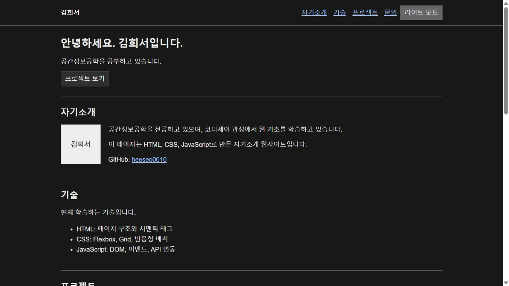

# 김희서 자기소개 웹사이트

공간정보공학을 공부하는 김희서의 자기소개와 GitHub 프로젝트를 소개하는 반응형 웹사이트입니다. 사용자 요청에 따라 장식을 줄이고 기본 글꼴, 흰 배경, 단순한 섹션 배치를 사용했습니다.

- 저장소: https://github.com/heeseo0616/heeseo-portfolio
- 사이트: https://heeseo0616.github.io/heeseo-portfolio/
- 사용 기술: HTML5, CSS3, JavaScript ES6+, GitHub REST API
- 외부 라이브러리와 프레임워크: 사용하지 않음
- 제작 도움: 사용자 요청으로 AI가 코드와 문서 작성을 지원했습니다.

## 실행 방법

VS Code에서 이 폴더를 열고 Live Server로 `index.html`을 실행합니다. 별도 설치나 빌드는 필요하지 않습니다.
Python이 있다면 `python -m http.server 8765` 실행 후 `http://localhost:8765`로 접속할 수도 있습니다.

## 파일 구조

- `index.html`: 인사말, 자기소개, 기술, 프로젝트, 문의, 푸터
- `css/style.css`: 반응형 배치와 라이트/다크 모드
- `js/config.js`: GitHub 계정 설정
- `js/main.js`: 메뉴, 테마, 스크롤, API, 폼 검사
- `images/`: 프로필 이미지와 화면 스크린샷
- `tests/check.mjs`: 외부 라이브러리 없는 자동 상태 검사
- `구현설명.md`: 주요 코드 원리

프로필 이미지는 실제 사진이 아닌 이름을 넣은 이미지입니다.

## 구현 기능

- 시맨틱 HTML, 이미지 alt, 입력 label, 키보드 초점 표시, 본문 바로가기
- 모바일 퍼스트, 768px 태블릿 및 1024px 데스크톱 분기
- Flexbox 네비게이션, auto-fit/minmax Grid 프로젝트 카드
- 모바일 메뉴 열기/닫기, Escape·외부 클릭·섹션 이동 시 닫기
- 다크 모드 전환과 localStorage 저장, 최초 방문 시 시스템 테마 반영
- 부드러운 앵커 이동, 60px 이상 스크롤 시 헤더 배경 변경
- 300px 이상 스크롤 시 맨 위 버튼 표시
- Intersection Observer threshold 0.2로 최소한의 화면 진입 효과
- 모션 감소 설정 시 스크롤/전환 효과 생략
- GitHub 공개 저장소 목록, 언어 필터, 로딩/성공/에러/빈 상태
- API 오류 시 재시도, 12초 시간 제한, 403·429 요청 제한 대응
- 문의 폼의 필수값·공백·이메일 검사, 필드 근처 오류 표시

문의 폼은 학습용으로 입력값을 검사하고 확인 메시지만 표시합니다. 실제 메일을 전송하거나 입력 내용을 저장하지 않습니다.

## API와 상태 변경

`js/config.js`의 `githubUsername`은 `heeseo0616`입니다.
GitHub API에서 최근 업데이트 순으로 최대 100개 공개 저장소를 가져옵니다. 인증 토큰은 사용하지 않습니다.

상태는 JavaScript의 `state`에서 관리합니다. 사용자 이벤트가 상태를 바꾸면 render 함수가 화면을 갱신합니다.
테마, 메뉴, API 응답, 언어 필터, 폼 검사에 이 흐름을 적용했습니다.
API 텍스트는 HTML에 넣기 전에 이스케이프합니다.

## 검증

`node tests/check.mjs`로 상태/이벤트 자동 검사 23개를 실행합니다.
이 검사는 DOM 대역과 가짜 API 응답을 사용하며 실제 브라우저 검증과 구분합니다.

로컬 브라우저에서 저장소 목록, 필터, 테마 유지, 모바일 메뉴, 폼 검사와 반응형 배치를 확인했습니다.
2026-10-30 GitHub Pages 배포를 진행했습니다. 배포 상태와 실제 접속 검증은 저장소의 Actions와 사이트에서 확인할 수 있습니다.

## 스크린샷

아래는 단순화한 디자인의 로컬 미리보기 화면입니다.

## 배포 설정

GitHub Pages의 Source는 Deploy from a branch, 브랜치는 main, 폴더는 /(root)입니다.
main 브랜치에 변경 사항이 저장되면 Pages 배포가 실행됩니다.

